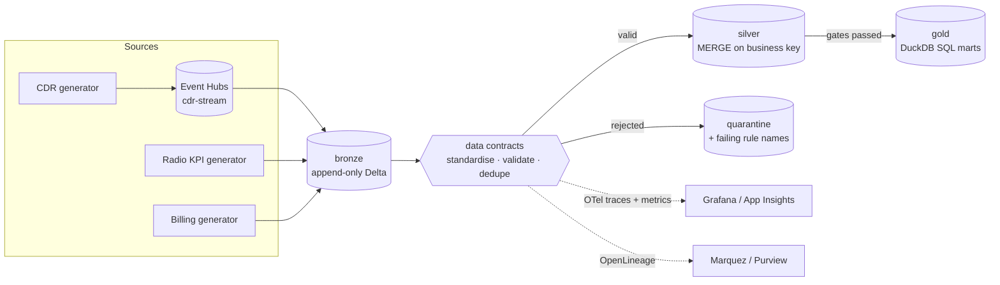
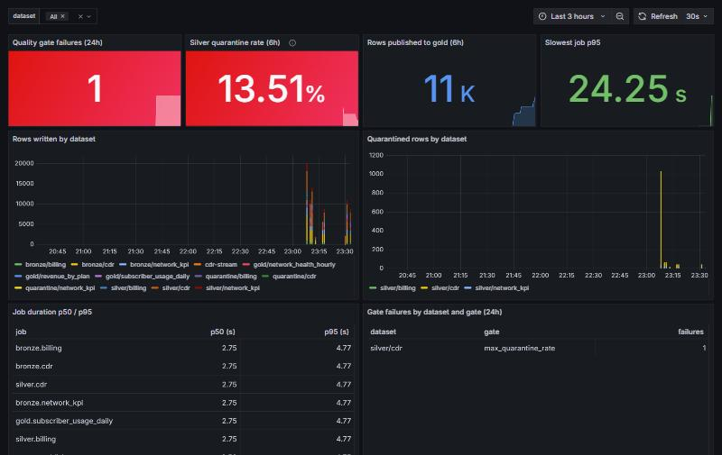
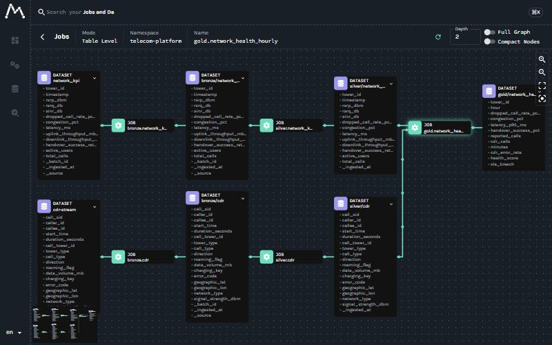

# Telecom Lakehouse on Azure

**A medallion lakehouse for telecom data. Data contracts, lineage and telemetry are built in. The same code runs on a laptop against Azure emulators and on Azure with keyless auth.**


Call detail records (CDRs), radio KPIs and billing data flow from **bronze → silver → gold** as Delta Lake tables.
- **Every silver table has a data contract.** Rows that fail it go to a quarantine zone, and the reason for each rejection is recorded on the row.
- **A failed quality gate blocks the gold layer.** Nothing reaches gold until the gates pass.
- **Every job is traced and lineage-tracked.** Traces and metrics go to OpenTelemetry; lineage goes to OpenLineage. Locally you see them in Grafana and Marquez. In Azure they go to App Insights and to any OpenLineage backend, such as Purview.



| | Laptop (`CLOUDKIT_MODE=local`) | Azure (`CLOUDKIT_MODE=azure`) |
|---|---|---|
| Lake | Azurite containers `bronze/silver/gold/quarantine` | ADLS Gen2, hierarchical namespace, shared keys **disabled** |
| Streaming | Event Hubs emulator (AMQP + Kafka) | Event Hubs Standard, local auth **disabled** |
| Engine | `deltalake` (Rust) + DuckDB, no JVM | same code, or Databricks / Fabric Spark via Terraform flags |
| Secrets | env vars via `cloudkit.get_secret` | Key Vault (RBAC mode) |
| Telemetry | Grafana LGTM (Tempo, Prometheus, Loki) | Application Insights + Log Analytics + KQL alert |
| Lineage | Marquez | any OpenLineage consumer (Purview, Marquez) |
| Auth | emulator well-known keys | Entra ID everywhere: managed identity, `az login` or GitHub OIDC |

The local stand-ins come from [azure-local-lab](../azure-local-lab). Every project in this portfolio shares that emulator stack.

## Quickstart (about 5 minutes)

```bash
(cd ../azure-local-lab && ./scripts/init-env.sh && docker compose --profile streaming up -d)
docker compose up -d                       # Marquez lineage server (UI on :3002)
uv sync
uv run python -m lakehouse --cdr 5000 --chaos 0.02 --stream
```

`--chaos 0.02` corrupts 2% of rows the way real feeds break: negative durations from clock skew, truncated records, sensor default values and replayed duplicates. That proves the contracts catch them. A real run:

```
batch 20261108T211024-b12b6d  mode=local  35.5s
table               in   valid  quarant.  dupes  gates
cdr               3060    2940        60     60  min_rows=ok max_quarantine_rate=ok key_unique=ok
network_kpi        979     941        19     19  min_rows=ok max_quarantine_rate=ok key_unique=ok
billing            510     490        10     10  min_rows=ok max_quarantine_rate=ok key_unique=ok
gold.network_health_hourly              941 rows
gold.subscriber_usage_daily             955 rows
gold.revenue_by_plan                      8 rows
RESULT: PASS
```

All 60 corrupted CDRs were quarantined and all 60 replayed duplicates were removed. Re-running the same batch is idempotent, because silver uses `MERGE` on the business key. At `--chaos 0.2` the quarantine-rate gate fails, gold is not published, and the process exits 1.

| Pipeline health (Grafana): `uv run python scripts/grafana_import.py` | Column-level lineage (Marquez) |
|---|---|
|  |  |

## What's in the box

| Path | What it is |
|---|---|
| [`lakehouse/`](lakehouse) | The runnable pipeline: storage per mode, data contracts, jobs, Event Hubs streaming, telemetry and lineage |
| [`lakehouse/quality.py`](lakehouse/quality.py) | Data contracts: row rules, synonym standardisation (`LTE → 4G`), business-key dedupe, publish gates |
| [`lakehouse/observe.py`](lakehouse/observe.py) | One `with observe.job(...)` context gives a span, row and quarantine counters, a duration histogram, and OpenLineage START/COMPLETE/FAIL events with schema, data-quality and row-count facets |
| [`infra/`](infra) | Terraform: one `platform` composition and four thin environment roots (dev / staging / prod / ephemeral) |
| [`.github/workflows/`](.github/workflows) | `ci` (unit tests, then emulator integration and a lineage check) · `infra` (fmt, validate, tflint, checkov, plan comment, optional infracost) · `ephemeral` (preview env per PR plus a nightly TTL janitor) · `promote` (staging → prod with a reviewed plan and a smoke run) |
| [`observability/grafana/`](observability/grafana) | Pipeline-health dashboard as code |
| [`ingestion/`](ingestion) | Synthetic generators: CDRs with fraud patterns, radio KPIs, billing, roaming, campaigns, complaints |
| [`ml/`](ml) | Churn, fraud, network-failure, propensity, pricing-elasticity and roaming models, trained on synthetic data |

## Infrastructure as code

`modules/platform` is the only thing environments call, so dev, staging and prod cannot drift apart structurally. They differ only in inputs:

| | dev | staging | prod | ephemeral (per PR) |
|---|---|---|---|---|
| Lake (ADLS Gen2) + Key Vault + Event Hubs + App Insights | ✓ | ✓ | ✓ (ZRS, 90-day logs) | ✓ |
| Data Factory | – | ✓ | ✓ | – |
| Databricks + Unity Catalog access connector | – | ✓ | ✓ | – |
| Fabric capacity + workspace + bronze/silver/gold lakehouses | – | – | ✓ | – |
| Event Hubs auto-inflate ceiling | off | 2 TU | 10 TU | off |

Design rules enforced in code and in `tests/test_phase0.py`:
- **Keyless.** Shared keys are off on storage, local auth is off on Event Hubs, Key Vault is in RBAC mode, and ADF and Databricks reach the lake through managed identities. CI authenticates with GitHub OIDC, so there's no client secret to leak.
- **Cost guardrails.** Expensive services sit behind flags. The log ingestion cap is 1 GB/day outside prod. Bronze moves to Cool storage after 30 days. Quarantine expires after 90 days. Preview environments are deleted when their PR closes, and a nightly janitor removes anything older than its TTL.
- **Policy as code.** checkov passes 24 checks with 0 failures. Every accepted exception (private endpoints, CMK) is listed with its reason in [`infra/.checkov.yml`](infra/.checkov.yml).

Validate locally without an Azure subscription:

```bash
cd infra/environments/dev && terraform init -backend=false && terraform validate
```

## Engineering notes: defects found and fixed

This repository began as a generated scaffold. Getting it to run end to end surfaced real defects, and each one is fixed and covered by a test:

| Area | Defect | Fix |
|---|---|---|
| Terraform | Never passed `terraform init`: duplicate `required_providers`, an `azulvm_eventhub` typo, duplicate outputs in every module, a nonexistent `hashicorp/kafka` provider | One provider definition per root, modules rewritten against real azurerm 4.x and `microsoft/fabric` schemas |
| Terraform | Invented resources (`azurerm_fabric_lakehouse`, `azurerm_databricks_workspace_policy`); two modules creating the same Fabric capacity; 30-day retention on Event Hubs Standard (maximum is 7) | Fabric via the official provider; one capacity; validation blocks on retention and partitions |
| Terraform | `timestamp()` in tags (a diff on every plan); a variable inside a `backend` block; no resource group created anywhere | Removed; partial backend config; the platform module owns the resource group |
| CI/CD | Preview environments were never destroyed: `closed` isn't a default `pull_request` trigger. Workflows installed files that don't exist and health-checked invented URLs | Explicit `types`, a TTL janitor, workflows that run what's actually in the repo |
| Data | ~30% of CDRs used `LTE` while every model expects `4G`/`5G`; the gate quarantined them on the first run | Contract-level standardisation (map synonyms, quarantine unknowns) |
| Data | CDR and KPI generators each invented their own tower IDs, so only 20% of cell-hours joined | One shared tower registry; join coverage is now 77% (the rest are idle cells) |
| Data | Billing marked accounts `overdue` but always set `num_overdue_months = 0` | Generator fixed; gold uses the authoritative status |
| Telemetry | The metric attribute `job` was silently overwritten by Prometheus's `job` label; default histogram buckets were too coarse for sub-second jobs | `pipeline_job` attribute; explicit buckets |
| Tests | One test generated 4.3M KPI rows (more than 15 minutes) and wrote parquet into the repo | Right-sized in-memory fixtures; that file now runs in about 20 seconds and the full suite in about 4 minutes |

## Status and roadmap

- [x] Runnable medallion pipeline (batch and streaming) on Azure emulators, with contracts, quarantine and gates
- [x] OpenTelemetry metrics and traces, Grafana dashboard as code, KQL alert on gate failures
- [x] OpenLineage to Marquez, plus a CI check that every gold table traces back to a source
- [x] Terraform validated against real providers; checkov clean; four workflows
- [ ] **dbt project** (`transform/dbt`): 25 models reference six models that are never defined and use MySQL functions against a Postgres profile. Next step: port the core layer to `dbt-duckdb` over the silver Delta tables
- [ ] First real `terraform apply` of `dev` on a free-credit subscription, with screenshots, then destroy
- [ ] Wire the `ml/` models to gold features (`subscriber_usage_daily`) instead of their own synthetic frames
- [ ] Fold the legacy `pipelines/` (PySpark) and `monitoring/` (in-memory) modules into `lakehouse/` or retire them

## Docs

[Architecture](docs/architecture.md) · [Runbook](docs/runbook.md) · [ADRs](docs/decisions/)

## License

Proprietary - Project
